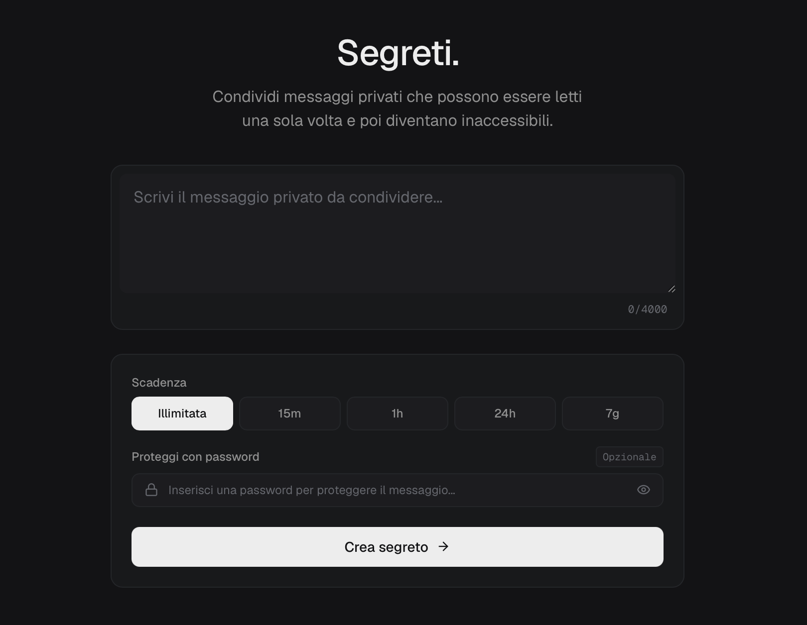
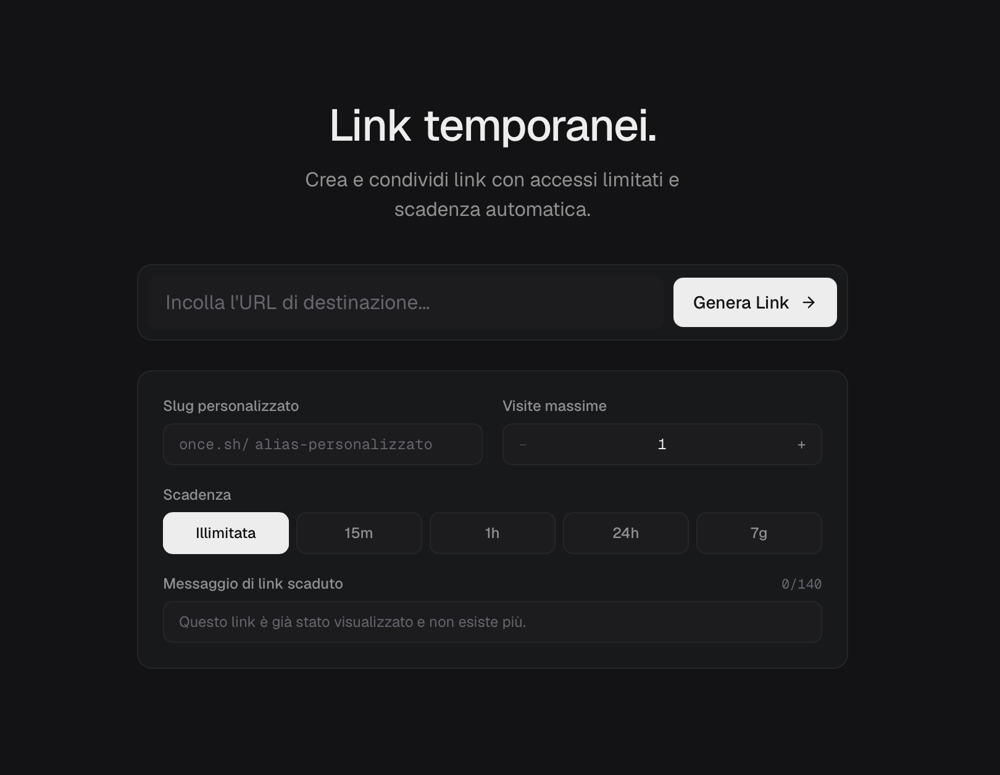

# ONCE

Temporary sharing. Nothing more.

Not everything we share needs to stay available forever.

ONCE is an open-source platform designed to make sharing temporary, simple and secure.

No accounts. No subscriptions. No unnecessary complexity.

[Visit ONCE](https://oncetool.it/)

Two tools. One idea.

## SECRETS

Share a message. Let it be read once.

SECRETS lets you share private text messages that become inaccessible after their first successful opening.

Every message is encrypted directly in your browser before being sent to the server. The decryption key is contained in the link itself and never reaches the server.

You can:
- Create encrypted messages without an account.
- Protect messages with an additional password.
- Set an expiration time.
- Share a unique link with the recipient.
- Allow only one successful reading.

Once opened, the encrypted content is consumed atomically and cannot be retrieved again.

## LINK

Share a link. Control how long it lasts.

LINK lets you turn any destination URL into a temporary, shareable link.

Instead of sharing a permanent URL, you decide how long the generated link remains accessible.

You can:
- Set a maximum number of visits.
- Choose an expiration time or keep the link active indefinitely.
- Create custom URLs with your own slug.
- Define a custom message to display when the link expires or reaches its access limit.

Each visit is counted atomically, ensuring that concurrent requests cannot exceed the configured access limit.

## Why ONCE?

The internet tends to make everything permanent.

ONCE takes a different approach: share what you need, for as long as you need it.

No accounts. No subscriptions. No advertising.

Just two tools built around temporary sharing.

## Open source

ONCE is open source and released under the GNU AGPL-3.0 license.
